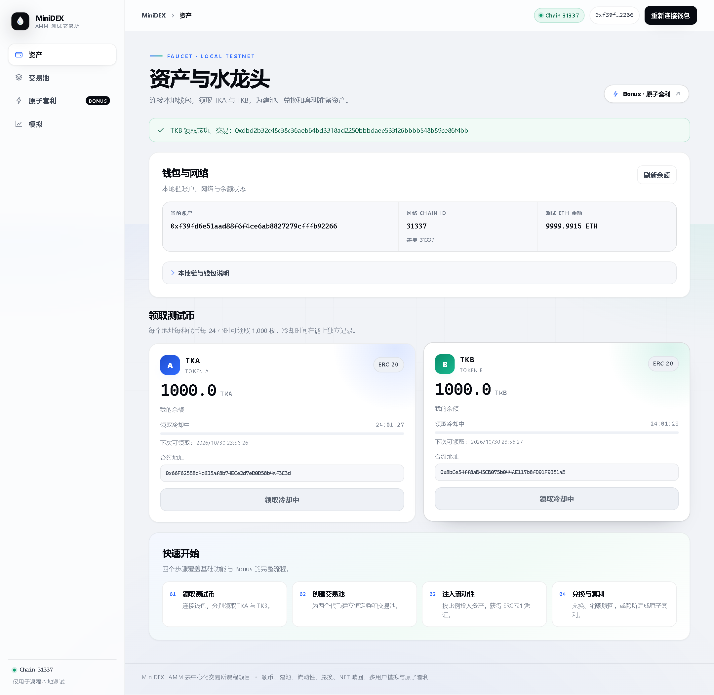
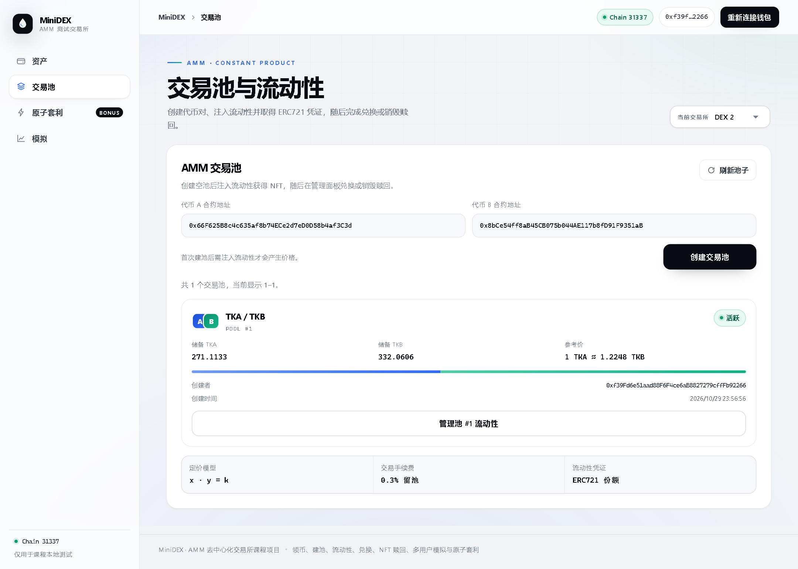
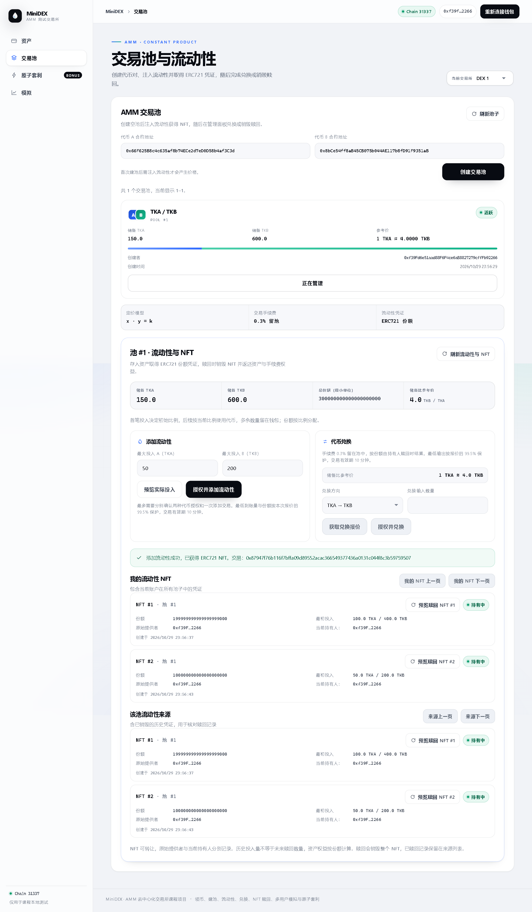
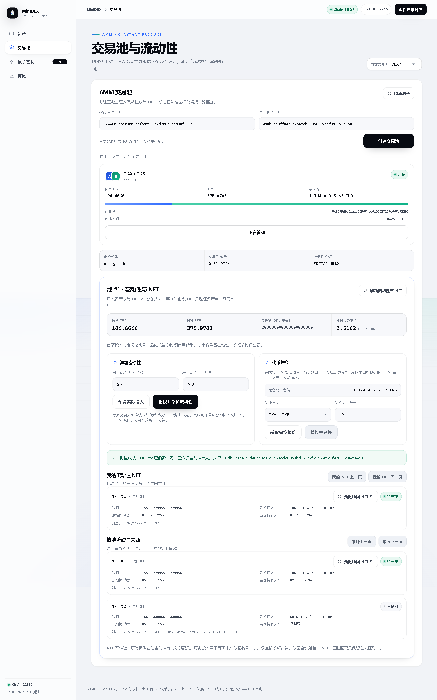
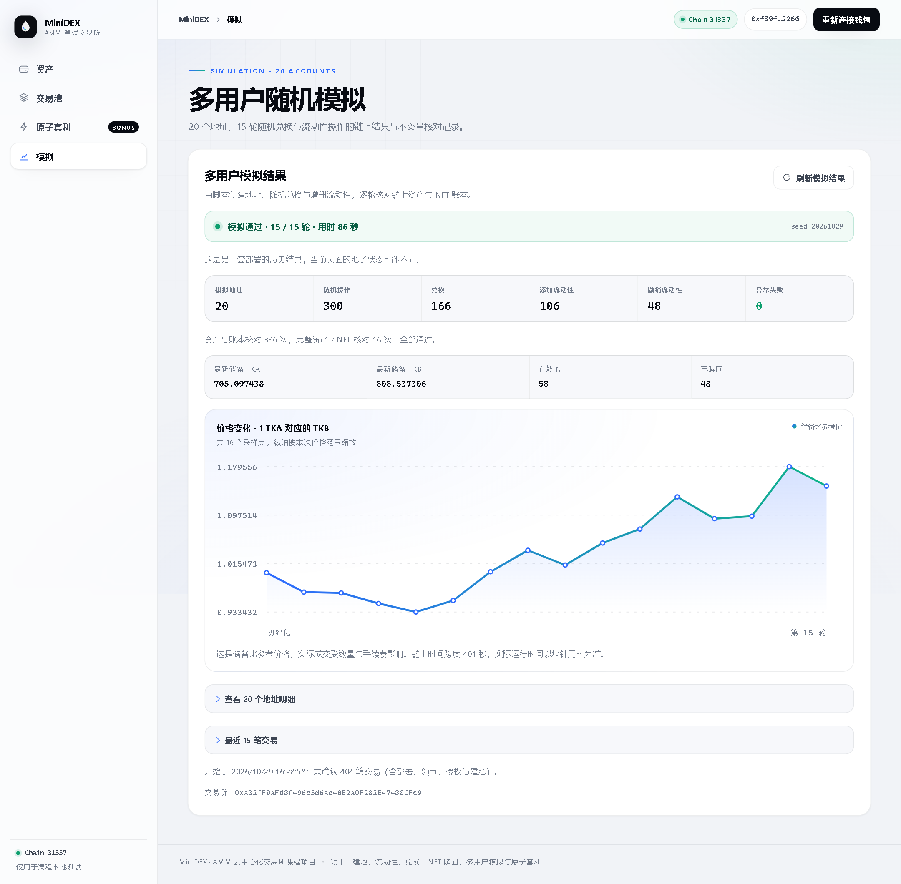
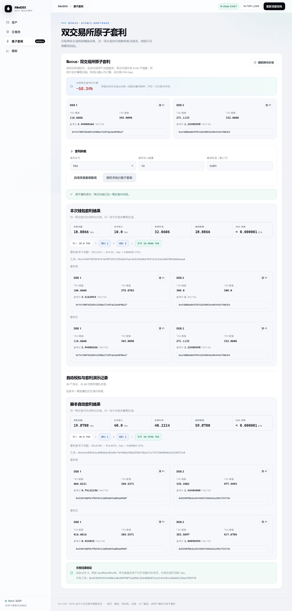

# MiniDEX：AMM 去中心化交易所课程项目

基于 [课程框架](https://github.com/LBruyne/ZJU-blockchain-course-2026) 实现的 AMM 去中心化交易所。支持测试代币领取、创建交易池、添加流动性、代币兑换和销毁 NFT 赎回，并实现了多用户随机模拟、双交易所与原子套利。

## 功能与实现

- 使用 OpenZeppelin ERC20 实现 `TestToken`，部署为 Token A（TKA）和 Token B（TKB），均为 18 位精度。
- 每个地址每种代币每次领取 1,000 枚，间隔 24 小时。初始发行量为零，成功领取时铸币；冷却由合约强制检查，不能通过刷新页面绕过。
- 前端支持钱包连接、网络切换、ETH 与代币余额读取、领币交易确认及领取冷却显示。账户切换后重新读取余额；交易确认后自动刷新。
- 部署脚本部署两个代币、两个 MiniDEX 和套利合约，并导出前端使用的地址与 ABI。
- 交易池按代币地址排序去重，记录零初始储备、创建者与时间；前端支持创建、刷新与分页查询。详见 [交易池实现说明](docs/pools.md)。
- 按池内比例收取流动性资产，每笔投入铸造 ERC721 凭证，支持查询个人 NFT、当前持有人与池子流动性来源。详见 [流动性说明](docs/liquidity.md)。
- 恒定乘积双向兑换收取 0.3% 手续费并留在池中；当前 NFT 持有人可销毁凭证，按当前份额取回资产及手续费权益。详见 [兑换与赎回说明](docs/trading.md)。
- 20 个地址运行 15 轮随机兑换、添加和撤销，生成逐笔报告与页面统计，检查资产守恒和 NFT 份额，并按交易回执复核结果。详见 [模拟说明](docs/simulation.md)。
- 两个交易所共享测试代币、独立维护池子。脚本通过随机交易形成价差、搜索盈利路线，再由套利合约在一笔交易内完成两次兑换；利润不足则全部回滚。前端可比较指定投入数量下的两个交易顺序并提交交易。详见 [Bonus 说明](docs/bonus.md)。

代币领取规则、验证结果和钱包配置见 [ERC20 与水龙头说明](docs/tokens.md)。

## 界面结构

前端是单页应用，按功能分为四个视图，由左侧导航切换，顶栏统一显示链 ID、当前账户与连接状态：

| 视图 | 内容 |
| --- | --- |
| 资产与水龙头 | 钱包与网络状态、测试 ETH 余额、TKA / TKB 领取入口与冷却倒计时、四步快速开始 |
| 交易池与流动性 | 切换交易所、按地址创建交易池、池子储备与参考价、分页查询；选中池子后展开流动性面板，完成预览、授权、添加、兑换与销毁赎回 |
| 原子套利 | 两所储备与价差、比较两个交易顺序、设置投入与最低利润、提交原子套利，以及历史演示与失败回滚记录 |
| 多用户随机模拟 | 模拟结论与操作统计、价格变化曲线、20 个地址的资产 / NFT / Gas 明细与最近交易 |

余额和池子储备从当前链读取，交易确认后刷新；模拟报告与套利演示显示已保存的运行记录。需要钱包的操作在未连接时禁用，网络不匹配时提供切换入口。390px 宽度下导航改为顶部标签，宽表格在容器内滚动。

## 如何运行

VMware 共享目录下，先在 Ubuntu 的项目根目录安装依赖：

```bash
node tools/install-shared.mjs
```

在三个 Ubuntu 终端分别执行：

```bash
# 终端一：项目 contracts/ 目录，启动本地链
npm run node
```

```bash
# 终端二：项目 contracts/ 目录，编译、检查、测试并部署
npm run typecheck
npm test
npm run deploy
```

```bash
# 终端三：项目 frontend/ 目录
npm test
npm run build
npm start -- --host 0.0.0.0 --strictPort
```

先部署再构建前端，保证生产构建包含最新的 `deployment.json`。该文件为本地部署产物，未纳入 Git；克隆项目后需要自行部署生成。本地内存链重启后也需要重新部署，再刷新网页。

Windows 通过虚拟机 IP 的 3000 端口访问网页；钱包 RPC 为 `http://127.0.0.1:8545`，Chain ID 为 `31337`，需在 Windows 保持 SSH 隧道：

```powershell
ssh -N -L 127.0.0.1:8545:127.0.0.1:8545 Ubuntu-64-bit
```

领取代币需要测试 ETH，可使用 Hardhat 的预置测试账户。完整路径、安装适配原因与启动说明见 [开发环境说明](docs/environment.md)。

## 运行模拟与套利演示

保持本地节点运行，在 `contracts/` 中执行：

```bash
# 20 地址随机兑换、添加和撤销，并复核结果
npm run simulate
npm run verify:simulation

# 双交易所随机交易、盈利套利和利润不足回滚，并复核结果
npm run bonus
npm run verify:bonus
```

两个演示脚本都会部署新合约并更新前端配置；按上述顺序运行后，前端指向双交易所部署，随机模拟仍可查看历史报告。运行结束后刷新网页；生产预览需重新构建前端。参数和结果分别见 [模拟说明](docs/simulation.md) 与 [Bonus 说明](docs/bonus.md)。

## 验证结果

2026-10-29 在 Ubuntu 对共享目录内同一份代码进行验证：

| 验证内容 | 结果 |
| --- | --- |
| 合约编译及 TypeScript 检查 | 通过 |
| 合约测试 | 34 条通过，覆盖基础功能与原子套利、利润不足整笔回滚和资金隔离 |
| 前端测试 | 14 条通过，覆盖钱包、模拟报告、套利选路与失败提示 |
| 前端类型检查及生产构建 | 通过 |
| 本地链多人领币 | 3 个账户各领取 1,000 TKA 和 1,000 TKB，重复领取均被拒绝 |
| 浏览器联调 | Chromium 通过本地 EIP-1193 测试适配器连接 Hardhat 链，完成领币、建池、添加流动性、兑换、赎回和套利；390px 宽度无页面横向溢出 |

浏览器联调使用测试适配器调用本地解锁账户，未操作真实 MetaMask 扩展的签名弹窗。

## 项目运行截图

截图来自本地链上的浏览器联调，记录了交易确认后的页面状态。

领取 TKA 和 TKB 后，页面显示余额与领取冷却时间：



创建交易池后可查询代币地址、创建者和储备；空池储备为零：



两名用户添加流动性后，页面显示各笔投入及对应 NFT：



详见 [流动性实现与验证说明](docs/liquidity.md)。

兑换按恒定乘积公式计算，0.3% 手续费留在池中。NFT 持有人销毁凭证后按当前份额赎回资产，详见 [兑换与赎回说明](docs/trading.md) 和 [验证数据](docs/step5-verification.json)。



多用户模拟使用 20 个地址运行 15 轮，共 300 次随机操作；含初始化与授权在内确认 404 笔交易，异常失败为零。详见 [模拟分析](docs/simulation.md) 和 [复核结果](docs/simulation-verification.json)。



Bonus 演示中，两所从相同初始价格出发，20 个地址执行 60 次随机交易形成价差。套利投入 40 TKA，返回 59.878806425488607914 TKA，代币利润为 19.878806425488607914 TKA，未折算 ETH Gas 成本。另发送一笔最低利润过高的交易，验证失败时两池储备和代币余额均回滚。详见 [Bonus 实现与结果](docs/bonus.md)。



## 参考内容

- [课程框架](https://github.com/LBruyne/ZJU-blockchain-course-2026)
- [课程 Demo](https://github.com/LBruyne/blockchain-course-demos)
- OpenZeppelin Contracts 5.4.0：使用 ERC20、ERC721Enumerable、ReentrancyGuard、SafeERC20 等合约与库。
