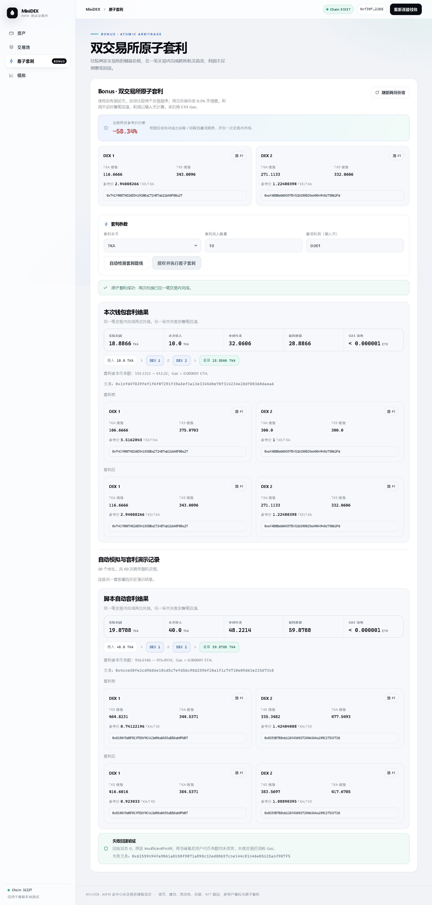
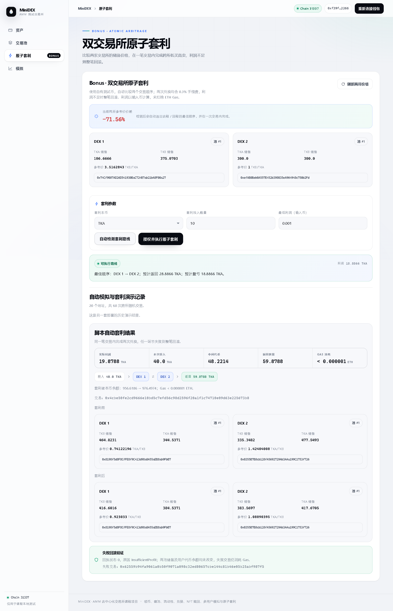

# Bonus：双交易所与原子套利

## 两个交易所和价差来源

部署脚本支持两个独立 MiniDEX 实例，二者共享 TKA、TKB，但各自维护池子、储备、流动性份额和 NFT。前端“当前交易所”选择器可切换全部建池、流动性、兑换与赎回操作，因此相同代币对在两个交易所拥有独立价格。

`demoBonus.ts` 用 20 个本地地址分别向两个池子投入 20 / 20，初始两个池子均为 400 TKB / 400 TKA，参考价格均为 1。随后执行 3 轮随机交易，每个地址每轮一次，共 60 笔；本次 DEX 1 分配到 31 笔，DEX 2 分配到 29 笔。

为了可复现地形成价差，随机订单流设置了不同的方向倾向：DEX 1 以 75% 概率选择 TKB→TKA，DEX 2 以 25% 概率选择该方向。交易所选择、地址顺序、数量和具体方向仍由种子 20261029 随机产生；不是先给两个池子设置不同初始价格。

## 自动检测与单笔执行

脚本在交易后读取两池报价，搜索两种本币、两个交易顺序和 1、2、5、10、20、40 枚候选资金，共 24 条候选路线，选择预计利润最大的正收益路线并自动调用套利合约。这是有限候选搜索，不保证全局最优投入数量。

`AtomicArbitrage.sol` 在构造时固定 DEX 1 和 DEX 2，执行参数不能指定其他交易所。执行前检查两池确为同一代币对；资金来自调用者本人，使用自有测试币，不需要闪电贷：

1. 从调用者转入本次本金，记录合约中原有的两种币余额。
2. 在第一个交易所兑换为中间代币，满足最低中间输出。
3. 在第二个交易所将中间代币换回本币。
4. 检查实际返回量不低于本金加最低利润，将本金和利润一并返还调用者。

以上全部发生在一次 `execute` 调用中。两次兑换均收取 MiniDEX 的 0.3% 手续费，报价已包含这些费用和价格冲击。第一腿滑点限制、期限、资金校验或最终利润检查任一失败，整笔交易 revert，包括两池状态、代币转移与本次内部授权变更。

最低利润必须大于零，且以输入币最小单位计算。合约校验实际余额增量，不把合约原有的捐赠余额当作收益；两次授权在成功后清零，执行有重入保护。资金直接转入合约不会成为调用者可套利的本金，也没有公开的捐赠余额提取接口。

## 实测套利结果（2026-10-29）

脚本完成 60 笔随机交易后，自动选择以 TKA 为本币，先在 DEX 1 买入相对便宜的 TKB，再在 DEX 2 卖出 TKB 换回 TKA：

| 项目 | 实际数据 |
| --- | --- |
| 投入本金 | 40 TKA |
| 第一腿获得 | 48.221439576229587148 TKB |
| 第二腿返回 | 59.878806425488607914 TKA |
| 代币利润 | 19.878806425488607914 TKA |
| 钱包本币余额 | 956.618675258233392856 → 976.497481683722000770 TKA |
| 成功交易 | `0x4cbe50fe2cd9666e10bd5c7efd56c98d2596f20a1f1c74710e09d63e225673b8` |

| TKA/TKB 储备参考价 | 套利前 | 套利后 |
| --- | --- | --- |
| DEX 1 | 0.741221956895317865 | 0.923033002593147096 |
| DEX 2 | 1.424040075669947837 | 1.088903948539572608 |

一张成功回执中包含两个不同交易所发出的 `Swapped` 事件和一个 `ArbitrageExecuted` 事件；用户本币余额增量与利润事件完全相等，中间代币余额不变，套利合约未留存本次资产。价差缩小，与在低价处买入、高价处卖出的行为一致。

这里的利润已经扣除了两腿 DEX 手续费，但未将消耗的测试 ETH Gas 折算成 TKA 成本；页面单独显示真实 Gas。演示使用本地自动挖块环境和有方向倾向的随机订单流，不代表真实市场的可实现收益。



## 真实失败交易和回滚证据

演示脚本随后以本币最低利润 10,000 枚发送一笔实际交易，显式提供 Gas 上限，使其真正进入区块。该交易两次兑换后触发 `InsufficientProfit`，回执如下：

- 失败交易：`0x62559b94fa9061a0b50f9071a098c32ed80657cbe144c81b46e05b25abf987f5`。
- 链上回执 `status = 0`，日志数量为 0。
- 交易跟踪返回的回滚错误为 `InsufficientProfit`。
- 两池储备、用户两种代币余额以及资金授权均与交易前一致。
- 失败交易仍支付 Gas，不能把 revert 描述为没有任何成本。

Hardhat 可能在发送时抛错，尽管交易已经挖出。脚本会以发送者、目标合约和精确 calldata 定位新块中的失败交易，再检查回执与执行跟踪，不以一次静态预检代替真实回滚证据。

## 前端与浏览器联调

前端的「原子套利」视图可自动比较输入本币在两个交易顺序下的返回量。若无正收益路线则禁用执行，用户可设定最低利润、确认有限额度授权，再提交原子交易。页面展示实际本金、中间数量、返回量、利润、钱包余额、Gas 和两池交易前后价格、储备；历史演示数据无需连接钱包即可查看。

真实 Chromium 通过本地 EIP-1193 钱包适配器额外执行了一次 10 TKA 套利，获得 **1.125534148475422841 TKA**，同一回执含两次兑换，钱包增量核对通过。两交易所的池子管理切换正常，390px 宽度无页面横向溢出，无页面脚本错误。本次没有操作真实 MetaMask 扩展的签名弹窗。



脚本历史报告和浏览器交互是两笔不同交易。后续手动交易会改变当前价格，报告中的“套利前/后”始终对应所记录交易的快照。

## 验证与产物

- 合约编译、类型检查与 **34 条测试**通过，新增 7 条套利测试覆盖正反方向、两跳同回执、最低利润回滚、亏损路线、第一腿滑点、捐赠余额隔离、非法路径 / 期限 / 数量，以及调用者资金授权。
- 前端 **14 条测试**、类型检查与生产构建通过，新增测试覆盖路线比较、亏损禁用、未连接状态和回滚提示。
- `verifyBonus.ts` 只读复核成功与失败交易的历史区块，验证利润、两池储备、失败代币和授权状态、Gas 与资产守恒，并检查报告的 224 笔成功回执和 60 笔随机交易。部署回执不计入这 224 笔日志。

产物：

- [完整演示报告](bonus-runs/1793264301350-20261029.json)
- [独立链上复核](bonus-verification.json)
- [浏览器交互复核](bonus-browser-verification.json)

## 再次运行

保持 Ubuntu 本地节点运行，在 `contracts/` 中执行：

```bash
npm run bonus
npm run verify:bonus
```

`bonus` 会部署一套新的双交易所和套利合约，准备代币与初始流动性、执行市场随机交易、自动套利并验证失败回滚，同时更新前端配置和 `public/bonus.json`。可用 `BONUS_SEED`、`BONUS_ROUNDS` 调整，轮数为 1–20；若当前参数未产生满足最低利润的路线，脚本报错并停止。模拟只允许本地 Chain ID 31337。

普通 `npm run deploy` 也部署双交易所与套利合约，但不自动准备流动性和订单流。`npm run simulate` 创建独立的单交易所模拟；运行它后前端会指向那套部署。

刷新页面读取最新配置；需要生产预览时，在上述步骤结束后于 `frontend/` 运行 `npm run build`。`verify:bonus` 默认核对最新历史报告，可通过 `BONUS_REPORT` 指定文件；复核依赖对应本地链的历史区块，内存链重启后旧报告仍可阅读，但需重新演示才能对新链进行复核。
