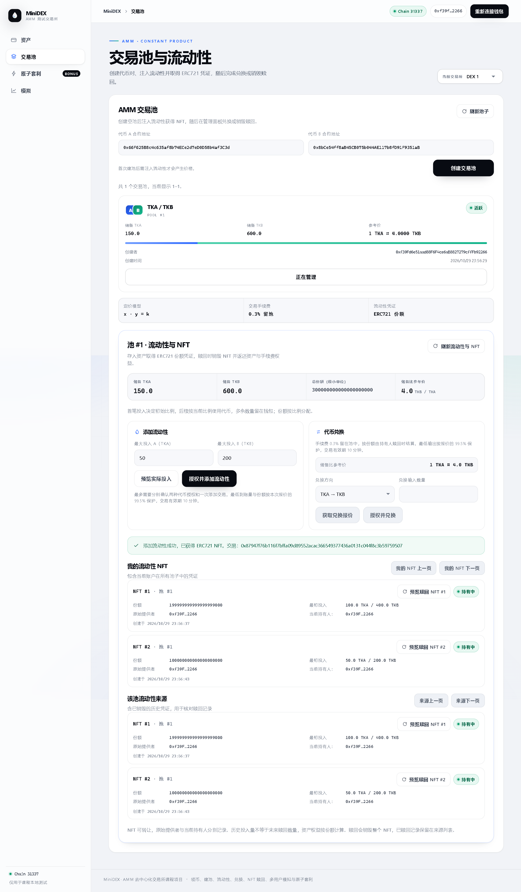

# 添加流动性与 ERC721 凭证

## 实际实现

MiniDEX 继承 OpenZeppelin `ERC721Enumerable` 和 `ReentrancyGuard`。每笔成功添加流动性产生一个 ERC721 NFT，名称为 MiniDEX Liquidity Position，符号为 MDLP，NFT 合约地址就是 MiniDEX 地址。

NFT 对应 `positions(tokenId)` 记录：池编号、流动性份额、实际投入 A/B 数量、创建时间和原始提供者。`ownerOf` 表示当前权益持有人；NFT 转移后，原始提供者记录保持不变，当前持有人与个人 NFT 列表随标准 ERC721 转移更新。`tokenURI` 返回 Base64 编码的 JSON，包含池子、代币地址、份额、投入量和时间，不依赖外部图片服务。

本文件记录第四步的添加与查询设计；第五步已加入兑换、手续费和销毁赎回，当前行为与数据见 [兑换与赎回说明](trading.md)。

## 份额计算与实际投入

数量在合约内部全部使用代币最小单位，前端按各代币 `decimals()` 转换。首次投入的份额基数为 `floor(sqrt(amountA × amountB))`，其中 1,000 个最小份额永久锁定，没有对应可转让 NFT，提供者获得其余份额。锁定份额与用户份额共同计入 `totalShares`，全部 NFT 赎回后池中仍保留这部分份额对应的资产。

池内已有储备时，合约选择不超过用户给定 A/B 最大投入的比例匹配数量；剩余数量不从钱包转出。新增份额为以下两值的较小值，向下取整：

```text
实际 A × 总份额 / 储备 A
实际 B × 总份额 / 储备 B
```

用户提供的最大数量不是实际消耗量。例如先投入 100 A、400 B 后，再提交最多 100 A、200 B，实际仅收取 50 A、200 B。后者获得 100 × 10^18 个最小份额，池内最终为 150 A、600 B，总份额为 300 × 10^18。

NFT 中的投入数量是历史数据，不能视作固定的未来赎回数量。后续交易会改变两种代币在池中的构成，权益需按 NFT 份额占总份额的比例计算。

## 交易约束

- 前端先调用 `previewAddLiquidity` 显示预计实际投入和份额，提交时重新报价。
- 授权以用户填写的本次最大数量为上限，不使用无限额度。已有非零不足额度时，先清零再授权，兼容要求零额度过渡的代币。实际按比例收取较少代币时，可能保留未使用额度。
- 添加交易包含最小 A、最小 B、最小份额与截止时间。前端使用报价的 99.5% 作为下限（至少一个最小单位），添加交易自提交时读取的最新区块起有效 10 分钟。
- `SafeERC20` 用于资产转入，每种代币的合约余额增量必须等于本次实际投入。扣费转账会整体回滚；不支持 rebasing 等会自行改变余额的代币。直接转入的代币不计入池子储备。
- 输入和池储备限制在 uint128 范围内，初始乘积不会溢出；后续乘除使用 `Math.mulDiv`。零投入、零份额、初始份额不足锁定量均被拒绝。
- 添加操作有重入保护。若第二种代币转入失败，第一种转入、储备、份额和 NFT 铸造均回滚。NFT 的安全接收回调发生前，位置与池状态已记录。
- 交易池注册额外检查 ERC20 `allowance`，避免将恰好也有 `balanceOf`、`totalSupply` 的 ERC721Enumerable 误认为 ERC20。

## 页面与查询

在池子列表点击“管理池 #1 流动性”，填写最大投入，预览后点击“授权并添加流动性”。根据已有授权额度，钱包可能需要确认清零授权、新授权和添加交易。每笔授权独立确认，若最终添加失败，已完成的授权仍保留；资产转入与 NFT 铸造在添加交易中原子执行。

下方显示当前账户在全部池子中的 NFT，以及所选池子的流动性来源。每条记录展示当前持有人、原始提供者、时间、历史投入和份额，按 10 条分页。`getPoolPositionIds`、`getOwnerPositionIds` 合约接口每页上限为 100；个人 NFT 查询遵循当前所有权。

合约已重新部署，需刷新页面读取最新地址。浏览器验证使用了前两个本地预置账户，它们已领取两种测试币并处于本轮冷却期；池 #1 中保留两笔流动性和 NFT #1、#2。

## 2026-10-29 实测结果

- 合约编译与 TypeScript 检查通过，19 条合约测试通过，其中新增流动性测试 8 条。
- 测试覆盖初始锁定份额、多人比例匹配、额度不足时全部回滚、零投入/微小投入/超大输入、滑点下限、过期、NFT 转移和分页、JSON 元数据、扣费代币拒绝以及 NFT 接收回调重入防护。
- 原有前端 6 条回归测试与类型检查通过，生产构建成功。构建器对约 505 kB 的主包给出体积提示，运行验证通过。
- Chromium 通过本地 EIP-1193 测试适配器连接真实 Hardhat 链，两个账户分别完成领币、授权和添加；池内储备为 150 TKB / 600 TKA，第二个账户的 TKB 余额为 950，实际只消耗 50 TKB，NFT #1/#2 归属正确。
- 刷新页面后 NFT 记录仍可查询，390px 宽度无横向溢出，未出现页面脚本异常。测试使用本地解锁账户适配器，没有操作真实 MetaMask 扩展签名弹窗。

浏览器联调脚本为 `tools/verify-liquidity.cjs`，需要 Ubuntu 已有 Playwright 或通过 `PLAYWRIGHT_MODULE` 指定其模块路径。在新部署后运行该脚本；它会实际使用前两个本地账户领取代币、创建池子和添加流动性，不应立即在同一部署上重复运行。


