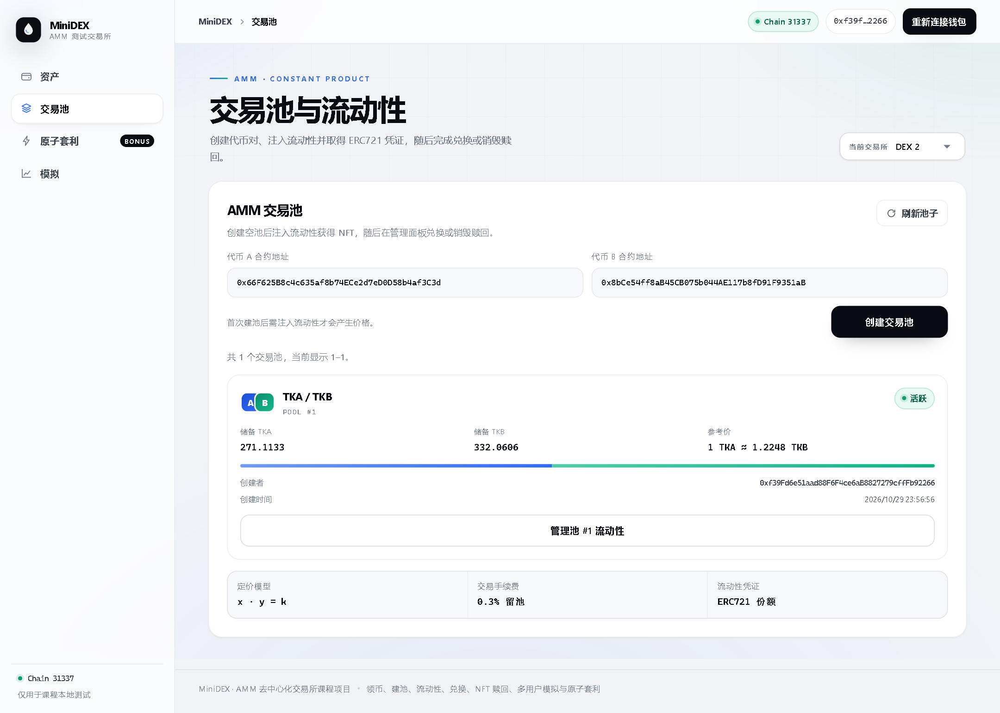

# 交易池创建与查询

## 实现范围

MiniDEX 支持交易池创建与查询。用户可在前端输入两个 ERC20 地址创建空池，并查看池子编号、两种代币地址、储备、创建者及创建时间。创建操作不转入资产，不要求持有代币或进行 approve；新池储备均为零，价格显示为待添加流动性。

代币地址按数值大小排序后保存，池编号从 1 开始，0 表示不存在。`getPoolId(A, B)` 与 `getPoolId(B, A)` 返回相同编号。同一交易所中，其他用户也不能为同一对代币再次建池；两个 MiniDEX 实例则可各自创建该代币对的池子，详见 [双交易所说明](bonus.md)。

合约拒绝零地址、相同地址、普通账户地址，以及不能响应 `totalSupply()`、`balanceOf(address)`、`allowance(address,address)` 的合约。这些查询只做基本的 ERC20 接口检查。资产转入和转出还会核对余额差值，不支持转账扣税或余额自动调整的代币。

创建成功后发出 `PoolCreated` 事件。`getPool(id)` 对不存在的编号回滚，`getPools(offset, limit)` 提供分页，每次最多 100 条，越界 offset 返回空数组。前端每页读取 10 条，避免列表无限增长时一次请求全部数据。储备按链上最小单位显示，以兼容不同精度的代币。

## 前端与部署

`PoolPanel.tsx` 接收钱包与网络状态，支持默认测试代币地址和手动输入其他 ERC20 地址。提交前检查输入及已有池编号；真实约束仍由合约执行。交易确认后重新查询列表，刷新网页也从链上恢复池子信息。

部署脚本现在导出 `miniDEX` 地址及 `dexAbi`。旧部署配置缺少这些字段时，应重新运行 `npm run deploy` 并刷新页面。重新部署会创建新的代币和交易所，旧合约仍在当前链上，但前端会使用新配置。

## 创建与查询阶段的验证结果（2026-10-29）

- Ubuntu 合约编译、TypeScript 检查通过，共 11 条合约测试通过，其中交易池测试 6 条，水龙头测试 5 条。
- 交易池测试覆盖地址排序、事件、储备初值、创建者与时间、正反向重复、跨用户重复、非法代币、零余额创建、分页边界及无效编号查询。
- 原有 6 条前端测试通过，前端类型检查和生产构建通过。
- 无头 Chromium 使用本地 EIP-1193 适配器连接真实 Hardhat 链，实际创建池 #1；相同代币输入被阻止，反向重复被识别且没有多发交易；刷新页面后仍能查询池 #1，储备为 0 / 0。390px 页面无横向溢出，未出现页面脚本错误。本项未操作真实钱包扩展签名弹窗。

## 重启说明

本地内存链在电脑或虚拟机重启后状态会丢失，文中的池编号和截图对应当次验证。重启后需启动本地链、重新部署生成配置，再启动前端与 Windows SSH 隧道，具体见 [环境说明](environment.md)。
