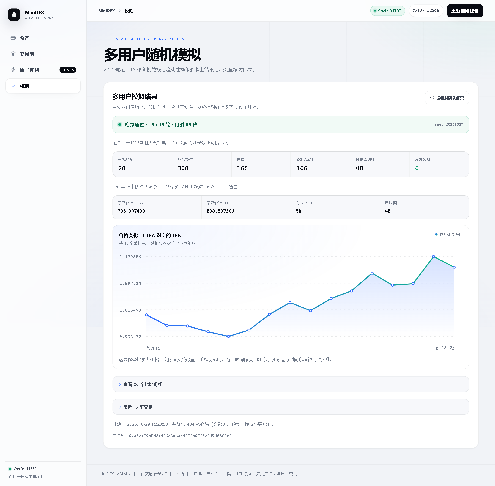

# 20 地址随机模拟与运行分析

## 本次完成的工作

`contracts/scripts/simulate.ts` 使用本地 Hardhat 节点提供的 20 个解锁测试账户。脚本部署一套新的 TKA、TKB 与 MiniDEX，将配置写给前端；每个地址领取两种代币各 1,000 枚，授权有限额度，并先投入 100 / 100 建立初始流动性。完成后前端指向本次模拟部署，历史部署和历史报告仍保留。

随机阶段共 15 轮，每轮先打乱 20 个地址的顺序，再让每个地址执行一次随机操作。默认概率为 55% 兑换、30% 添加、15% 撤销；若抽到撤销但没有有效 NFT，则改为添加。兑换方向、数量、添加上限、待赎回的 NFT 也由固定种子随机选择。输入量会受钱包可用余额约束，额度不足时补充有限授权。脚本串行发送并确认交易，避免账户 nonce 竞争，操作之间间隔 250ms。

这次实现的是多个地址交替操作的稳定性模拟，不是并发吞吐量或真实用户网络压力测试。固定种子和相同参数可复现动作选择与金额序列；部署地址、交易哈希、区块时间和 Gas 费用可能随链状态变化。

## 实际运行结果（2026-10-29）

| 项目 | 实测值 |
| --- | --- |
| 不同地址 | 20 |
| 每个地址随机操作 | 15 次 |
| 随机操作总数 | 300 |
| 初始化添加 | 20 次 |
| 兑换 | 166 次 |
| 添加流动性 | 106 次，含 20 次初始化，即随机添加 86 次 |
| 撤销流动性 | 48 次 |
| 确认交易总数 | 404，含 3 次部署、40 次领币、40 次授权、1 次建池、20 次初始化添加、300 次随机操作 |
| 异常失败 / 跳过 | 0 / 0 |
| 实际墙钟用时 | 86 秒 |
| 结束区块 | 462 |
| 最终有效 / 已赎回 NFT | 58 / 48，合计历史铸造 106 个 |

初始池为 2,000 TKA / 2,000 TKB，参考价格为 1。随机兑换和流动性变化后，结束时储备为 **705.097438231499571018 TKA / 808.537305743908992365 TKB**，储备比参考价格为 **1.146702940478487107 TKB/TKA**。这是池子资产构成变化的结果，不能将某一种代币的余额变化直接解释为用户总收益。

链上记录的时间跨度为 401 秒。Hardhat 自动挖块的区块时间会前进，因此它和真实用时 86 秒分开报告，未用链上时间替代实际运行时间。

## 运行期间如何检查正确性

每次添加、兑换、撤销后，脚本按事件更新独立的交易账本，并核对调用者钱包变化、池内储备、实际资产余额和总份额。兑换输出另用恒定乘积含费公式计算，检查储备乘积不下降；赎回数量按当前储备和 NFT 份额独立计算。失败会停止运行，将部分结果标为 failed 并保存错误，不会将异常当作成功跳过。

累计执行 336 次核心核对，其中 16 次同时执行完整核对（初始化后一次、每轮结束一次）：

- DEX 内实际两币余额分别等于池内记账储备，且与事件账本一致。
- 所有地址钱包余额加池内余额等于该代币总发行量，两币均为 20,000 枚，没有出现额外铸币或丢失资产。
- 活跃 NFT 的份额合计加 1,000 个锁定最小份额等于池子的总份额。
- ERC721 总数、各地址持有数量、枚举列表与账本一致；没有重复 NFT 编号。
- 每条位置记录的份额、池编号、持有人或赎回记录一致，来源分页包含全部 106 个历史位置，包括已赎回项。
- 每个地址都完成 15 次随机操作，三类操作均实际执行。

## 独立复核

`contracts/scripts/verifySimulation.ts` 以只读 RPC 在记录的结束区块复核完整报告，并逐笔读取全部 404 个真实回执，检查成功状态、发送者、区块、Gas、兑换 / 添加 / 赎回事件及操作计数。随后对比每个用户的最终余额、NFT 数量及全局资产守恒，结果通过。

- [完整运行记录](simulation-runs/1793262538112-20261029.json)：含每笔交易、事件数量、用户统计和 16 个快照。
- [独立复核结果](simulation-verification.json)：记录已核验的区块、地址数和回执数。

报告不保存私钥。`frontend/public/simulation.json` 只是当前结果的展示副本，和 `deployment.json` 一样未纳入 Git；完整历史 JSON 与截图保存在 `docs/` 内。

## 前端展示与浏览器验证

前端的「多用户随机模拟」视图无需连接钱包即可查看操作统计、检查次数、逐轮价格、20 地址的余额 / NFT / Gas 明细及最近交易。报告来自不同部署时会明确标注历史结果；运行中每 5 秒刷新，完成后停止自动刷新。显示通过状态前检查记录中的地址数、参与轮数和检查结果是否一致。

Chromium 实测确认 20 地址明细共 21 行（含表头），与生成报告一致；当前部署标识一致。另以本地测试钱包适配器查看了池子的来源第一页和第二页，包含已销毁记录时也可正常读取。390px 宽度无页面横向溢出，无页面脚本错误。27 条合约回归测试、10 条前端测试、类型检查及生产构建均通过。



钱包余额不包含仍在 NFT 中的资产权益，Gas 按本次交易实际消耗的测试 ETH 单独统计，未折算为统一计价币收益。

## 如何再次运行

先在 Ubuntu 保持本地 Hardhat 节点运行，在项目 `contracts/` 目录执行：

```bash
npm run simulate
npm run verify:simulation
```

`simulate` 自行部署新合约并导出前端配置，不需要先手动部署；运行结束刷新网页即可查看新池子及结果。生成生产页面时，在模拟完成后于 `frontend/` 执行 `npm run build`，将最新配置和结果一并复制到构建目录。

可通过环境变量调整，但本次真实结果来自默认参数：

```bash
SIM_USERS=20 SIM_ROUNDS=15 SIM_INTERVAL_MS=250 SIM_SEED=20261029 npm run simulate
```

`SIM_USERS` 至少 20，且不能超过节点实际提供的解锁地址数。轮数为 1–100，间隔为 0–10,000ms。模拟只接受 Chain ID 31337；Gas 使用本地预置账户已有的测试 ETH。模拟时应避免对这套新部署手动交易，否则独立账本会检测到外部状态变化并停止。

`verify:simulation` 默认选择最新完整历史报告，也可用 `SIM_REPORT` 指定 JSON 文件。它依赖对应链的历史区块和回执；电脑重启导致内存链丢失后，旧报告仍可阅读，但不能在新的链状态上重新进行 RPC 复核，需要重新模拟生成新结果。
