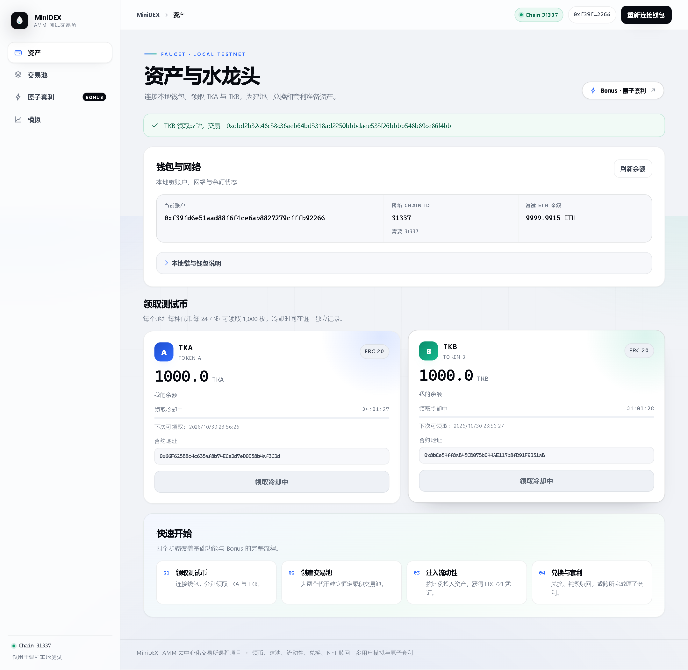

# ERC20 测试代币与水龙头

## 实现与设计

`contracts/contracts/TestToken.sol` 继承 OpenZeppelin ERC20，部署脚本用同一个实现分别创建 Token A（TKA）与 Token B（TKB）。两个合约地址不同，余额、总发行量和领取记录互不影响，均沿用 ERC20 默认的 18 位精度。

本次没有在构造函数预铸币，也没有开放任意数量的 mint 接口。用户调用 `claim()` 后获得固定的 `1000 × 10^18` 最小单位，即 1,000 枚代币。合约通过 `nextClaimAt[address]` 记录该地址下一次允许领取的区块时间；提前领取会以 `FaucetCooldown(availableAt)` 回滚。成功领取会发出 `TokensClaimed` 和标准 ERC20 `Transfer` 铸币事件。

领取限制以地址为单位，用于控制本地演示中重复点击，并不防止同一人创建多个地址。本项目仅使用测试资产，不涉及代币实际价值。测试 ETH 使用本地链预置账户提供，没有实现单独的 ETH 水龙头合约。

## 部署与前端衔接

在 `contracts/` 执行 `npm run deploy` 会部署两个代币和 MiniDEX 骨架，将链 ID、代币地址、代币 ABI 和部署时间写入 `frontend/public/deployment.json`。该文件仅包含公开链上信息，但地址随本地部署变化，因此被 Git 忽略。

前端启动时读取部署配置，然后通过浏览器注入的 EIP-1193 钱包和 ethers 连接链。读取代币前会检查链 ID、合约代码与代币符号，减少本地链重启后误用旧地址的问题。交易广播后显示交易哈希，等待 receipt 确认后重新读取余额和领取时间；合约始终是冷却限制的最终依据，页面显示使用本机时钟。

前端监听 `accountsChanged` 和 `chainChanged`，清除并重新读取对应状态。初始化查询使用修订计数，防止迟到的查询结果覆盖用户刚完成的连接或切换。

## 在浏览器中使用

1. 启动 Ubuntu 本地链、部署合约并启动前端，具体命令见项目 README。
2. Windows 中建立 SSH 隧道，将本机 `127.0.0.1:8545` 转发到 Ubuntu 同一端口。该转发只监听 Windows 本机。
3. 在安装了 MetaMask 等钱包扩展的浏览器中打开前端。应用内预览浏览器可能没有钱包扩展。
4. 在钱包添加本地网络：RPC `http://127.0.0.1:8545`、Chain ID `31337`、货币符号 `ETH`。页面也提供切换网络按钮。
5. 导入本地 Hardhat 节点输出的开发测试账户，或自行向测试地址转入测试 ETH。节点日志包含测试私钥，只在本机查看，不提交仓库。不要导入或使用真实资产账户。
6. 点击连接钱包，再分别领取 TKA 和 TKB。每笔领取都需要钱包确认；确认后页面显示新余额及下次领取时间。

第二步浏览器联调使用了第一个预置账户，多用户脚本使用最后三个预置账户。后续重新部署或重启内存链后，这些旧代币领取记录不会带到新合约，当前额度应以页面链上查询为准。需要清空演示状态时可重新部署，并刷新前端；无需为了重置代币而停止本地链。

## 实测结果

- 合约测试验证两种币的元数据、零初始供应、不同用户及不同代币独立领取、领取事件、冷却期内拒绝、边界时刻重新领取，以及转账、approve 和 transferFrom。
- `npm run verify:tokens` 在 Chain ID 31337 上使用最后三个解锁测试账户，分别发送六笔领币交易。每个账户获得 1,000 TKA 和 1,000 TKB，随后静态调用重复领取均返回 `FaucetCooldown`。该脚本会实际改变本地测试状态；同一部署上立即重跑会受到冷却限制，应先重新部署。
- 前端六条测试通过，覆盖无钱包、缺少部署文件、领取确认后余额与冷却更新、网络切换、账户切换和断连，以及钱包拒绝。
- 无头 Chromium 通过本地 EIP-1193 测试适配器使用真实本地链完成两笔领币，页面显示 1,000 TKA 和 1,000 TKB，切换账户后余额更新为零，无页面脚本异常，390px 宽度无横向溢出。此项没有验证真实钱包扩展的签名弹窗。

