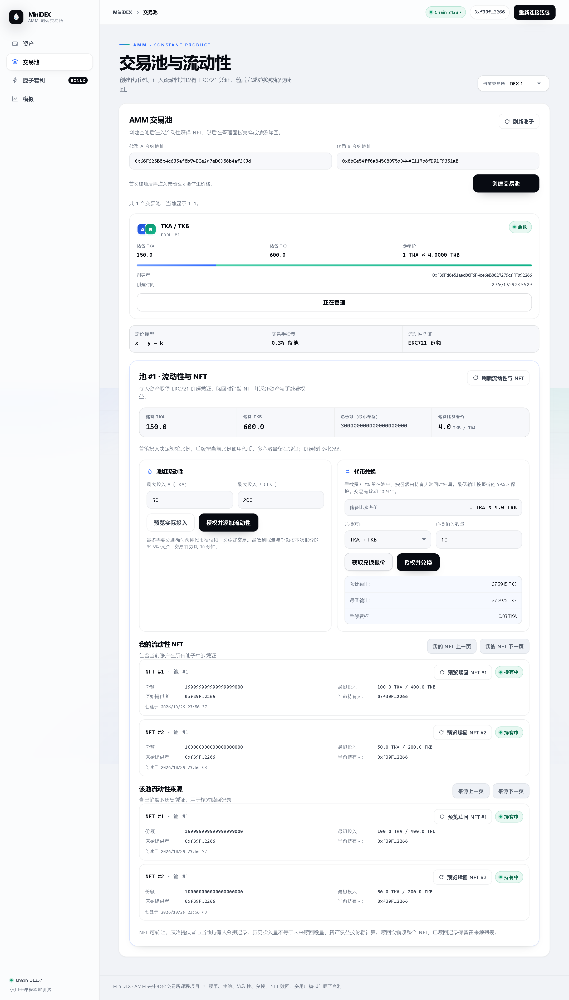
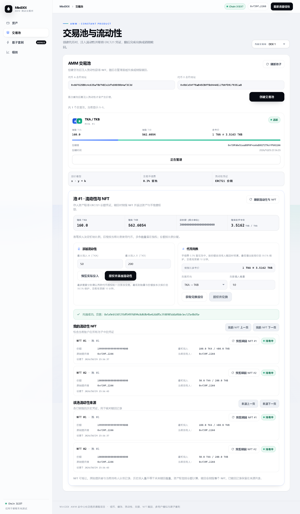
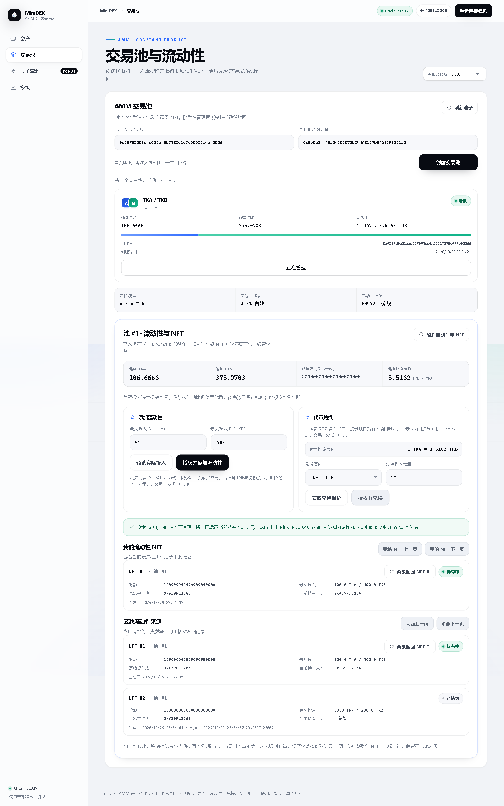

# 恒定乘积兑换、手续费与 NFT 赎回

## 完成内容

`MiniDEX` 新增 `quoteSwap`、`swap`、`previewRemoveLiquidity` 和 `removeLiquidity`。前端在池子的管理页面展示参考价格、兑换方向、报价、最低输出、手续费，并支持预览后确认销毁整张 NFT 赎回两种资产。

## 兑换与手续费

手续费固定为输入数量的 0.3%，所有手续费留在池内，不单独转给管理者，也不另建可重复领取的手续费余额。设输入侧储备为 x、输出侧储备为 y、输入数量为 dx：

```text
有效输入分子 = dx × 9970
输出数量 = floor(有效输入分子 × y / (x × 10000 + 有效输入分子))
新输入储备 = x + dx
新输出储备 = y - 输出数量
```

报价和交易使用同一计算函数，支持 A→B 与 B→A。整数计算向下取整，手续费展示值为 `floor(dx × 30 / 10000)`；计算输出时保留费率分子的精度，不先把有效输入截断到整数。乘除使用 `Math.mulDiv`，实际输入和最终储备仍受 uint128 上限约束。

`swap` 在收到完整输入后更新储备，再向调用者发送输出；交易包含最低输出和截止时间。报价后发生不利交易，结果低于最低输出时整笔回滚。前端必须先获取报价，提交时保留该报价的 99.5% 作为最低输出；授权等待期间价格变化也受此约束。池子储备比仅是边际参考价，实际输出包含手续费和交易数量对池子的影响。

手续费增加池内资产权益，持有人按份额赎回时一起结算。费用没有被单独记成“固定利润”；交易同时改变资产构成，所以不能把某一种币的余额增加直接称为总盈利。锁定的最小份额也参与分母，其对应的微小资产部分不可赎回。

## 销毁 NFT 赎回

每次赎回销毁整张 NFT，不支持部分份额赎回：

```text
取回 A = floor(当前储备 A × NFT 份额 / 总份额)
取回 B = floor(当前储备 B × NFT 份额 / 总份额)
```

取回量使用当前储备，已经包含手续费留池的影响。只有 `ownerOf(tokenId)` 对应的当前持有人可直接调用赎回；原始提供者在转出 NFT 后失去赎回权，获批操作 NFT 的地址也不能直接调用赎回把资产取走。

赎回先验证两种最小取回量及期限，再扣减份额和储备、记录赎回时间与领取者、销毁 NFT，最后转出代币。任一步失败，包括转出代币扣费，均回滚整个交易。出入账都检查 DEX 和接收者的余额变化，继续拒绝扣费转账；不支持 rebasing 代币。

已销毁 NFT 的 `ownerOf`、`tokenURI` 及再次赎回会失败；原始 `positions`、`redeemedAt`、`redeemedBy` 和池子的来源编号保留为历史数据。个人 NFT 列表只包含仍持有的 NFT，池子来源列表同时显示有效与已赎回记录。前端对同一批储备、所有权和赎回记录使用固定区块读取，避免并发交易导致查询到互相矛盾的状态。

## 编译调整

功能加入后，未优化版本超过 EVM 24,576 字节部署上限；普通优化又触发编译器栈深限制。本次在 Solidity 0.8.20 配置中启用 optimizer（runs 200）与 viaIR，未关闭链上的合约大小检查。实际已部署字节码为 14,024 字节。

## 实际验证（2026-10-29）

Ubuntu 合约类型检查与 27 条测试通过，新增 8 条测试覆盖双向兑换和手续费、旧报价失败回滚、空池/无效/微小/超大输入、兑换授权、过期交易、当前份额赎回、转让后的权限、最小取回量、多位置及共享代币池隔离、扣费代币导致的兑换和赎回回滚。原有 6 条前端回归测试通过，前端类型检查和生产构建通过。

真实 Chromium 使用本地 EIP-1193 适配器连接本地链，先创建 150 TKB / 600 TKA 的池子，再执行：

| 操作 | 实际结果 |
| --- | --- |
| 输入 10 TKB | 输出 37.394511470900793898 TKA，手续费展示为 0.03 TKB |
| 反向输入 5 TKA | 输出 1.405238488169465996 TKB，手续费展示为 0.015 TKA |
| NFT #1 转给第二个用户 | 原提供者页面不再提供其赎回操作，当前持有人可查看权益 |
| 第二个用户销毁 NFT #2 | 到账 52.864920503943511334 TKB 和 189.201829509699735367 TKA |
| 赎回后池内储备 | 105.72984100788702267 TKB / 378.403659019399470735 TKA，NFT #1 仍有效 |

两次兑换后储备乘积均增加。浏览器核对了钱包余额增量与合约报价完全一致；刷新后仍能查询已销毁记录，390px 宽度无横向溢出，无页面脚本异常。测试适配器使用本地解锁账户，没有验证真实 MetaMask 签名弹窗。

完整数值、交易哈希与合约大小见 [实际验证数据](step5-verification.json)。浏览器复验脚本为 `tools/verify-swap-remove.cjs`：需先重新部署生成新配置，并准备 Ubuntu Playwright，或用 `PLAYWRIGHT_MODULE` 指向现有安装。脚本会实际领币、建池、添加、兑换、转让和赎回，不应在同一部署上立即重复执行。







本次重新部署后，旧部署数据仍属于旧合约，刷新页面读取新配置即可。当前新部署中 NFT #1 属于第二个预置账户，NFT #2 已销毁。所有改动和截图均在本地，未推送 GitHub。
